# Adaptive Curriculum Optimization for Physics-Informed Neural Networks

PINN 优化器、物理约束学习顺序与曲率辅助调度的研究代码和实验记录。

**当前状态：已有优化器与规则调度预实验。** 

- [2 页 Research Note（PDF）](reports/PINN_Optimization_Research_Note.pdf) · 
- [实验证据与局限](reports/experiment_evidence.md) · [全部指标 CSV](reports/verified_metrics.csv)
- [源文件与压缩数据 SHA256 清单](provenance/source_manifest.json)


## 实验范围与公平性

|实验|PDE / 数据与边界|网络参数|训练点|比较预算|
|---|---|---:|---|---|
|一维热方程|$u_t=0.1u_{xx}$；$x,t\in[0,1]$；两端零 Dirichlet，初值含两个正弦频率|697；2-24-24-1 tanh|内点128、IC48、两端BC各48|每方法1200外层步|
|二维稳态热传导|$-\Delta T=q$；单位方域、零 Dirichlet；解析解含两个空间频率|697；2-24-24-1 tanh|内点128、BC每边16|每方法1200外层步|
|二维弹性载荷反演|平面应力矩形弹性体；底部固定、侧面自由、顶面未知法向压力；48个无噪声位移观测，FEM参考|990；共享场网络与独立压力头|内点64、顶面/两侧各16、观测48|每方法1200外层步|
|Hertz/KKT接触|平面应变圆柱压刚性平面，力控制、无摩擦，FB互补残差；无预设接触区|1370；4-24-24-24-2|内点256、弧128、顶面32，另有积分/虚功点|最多2400外层步，更新计时软上限120秒|
|A–E调度：热传导 / NS|二维稳态热传导与Re=20 Kovasznay流；NS四边给速度，单点$p(0,0)=0$，无内点真解监督|2241 / 2307；3×32 tanh|内点256、BC每边32；另有固定独立探针|每组约60秒计费训练预算|

每个 PDE/种子内部共享初始化、采样、损失定义和验证点；主对照均为 **seed=42、CPU单线程、float64**。不同优化器使用各自明示的学习率，尚未做等量超参数搜索。


`*` 表示项目中的教学性自实现核心；SOAP、MultiAdam、PCGrad、ConFIG、DCGD，“GN / LM”是同一个阻尼Gauss–Newton实现，并未独立测试纯GN。AdamW、独立Shampoo、Newton-CG与NNCG仅列入调研，没有独立训练结果。

## 1. 一维热方程：10种优化方法

解析真解为

$$u^*(x,t)=\sin(\pi x)e^{-0.1\pi^2t}+0.3\sin(3\pi x)e^{-0.9\pi^2t}.$$

损失为PDE、初值和边界三项MSE等权相加。下表是**最终检查点**，相对 $L^2$ 为固定时空网格上的离散误差，越小越好；不是分类准确率。

|方法|最终总Loss|相对 $L^2$|更新耗时(s)|
|---|---:|---:|---:|
|Adam|2.661e-02|8.328%|4.67|
|SGD + Momentum|2.764e-02|8.688%|4.33|
|RMSProp|2.955e-02|10.699%|4.98|
|L-BFGS|9.552e-06|0.122%|11.76|
|Adam → L-BFGS|3.437e-05|0.338%|7.95|
|GN / LM*|1.000e-10|0.015%|182.84|
|MultiAdam*|3.945e-02|10.574%|6.70|
|PCGrad + GD*|3.016e-02|10.094%|9.95|
|ConFIG + GD*|4.174e-02|11.160%|9.39|
|SOAP*|1.559e-05|0.264%|5.03|

**各项损失与误差曲线**

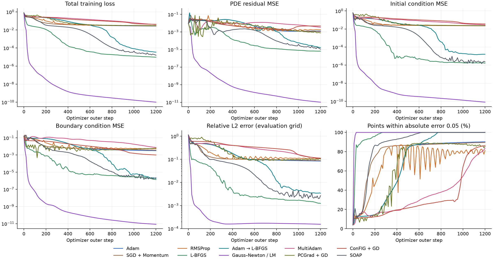

**训练过程中的预测向解析曲线靠近：** 各方法来自同一初始化；GIF保留不同时间切片。

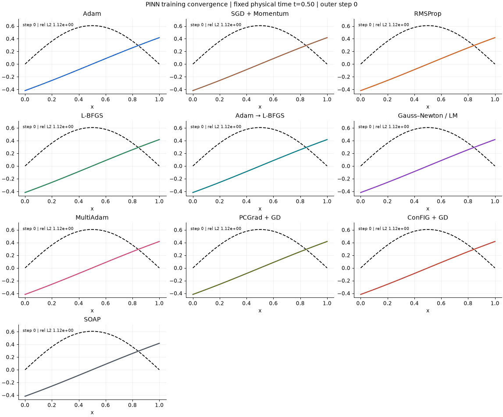

完整记录：[实验报告](pinn_optimizer_lab/runs/demo/experiment_report.md) · [逐方法JSON/CSV和最终权重](pinn_optimizer_lab/runs/demo) · [公式与实现说明](pinn_optimizer_lab/README.md)

## 2. 二维热传导与合成载荷反演

热传导解析解为

$$T^*(x,y)=\sin(\pi x)\sin(\pi y)+0.2\sin(3\pi x)\sin(2\pi y),\qquad q=-\Delta T^*.$$

反演使用独立P2有限元生成位移观测；压力非负且支撑区预先已知。**这是简化的合成载荷反演，不是未知接触区的Hertz/KKT接触。** 原始损失权重、单位、FEM网格收敛检查见项目说明与配置。

|方法|热传导相对 $L^2$|热更新秒|反演位移相对 $L^2$|压力相对 $L^2$|合力相对误差|反演更新秒|
|---|---:|---:|---:|---:|---:|---:|
|Adam|2.552%|4.35|45.467%|69.289%|62.115%|7.93|
|SGD + Momentum|6.926%|4.74|37.127%|67.164%|65.759%|3.31|
|RMSProp|5.684%|5.01|46.077%|71.263%|62.263%|7.85|
|L-BFGS|0.102%|12.60|3.580%|9.847%|2.476%|17.62|
|Adam → L-BFGS|0.207%|8.89|4.629%|13.448%|3.998%|13.60|
|GN / LM*|0.003%|96.37|0.836%|1.498%|0.412%|174.74|
|MultiAdam*|24.084%|8.12|52.976%|84.902%|83.553%|11.56|
|PCGrad + GD*|9.108%|7.47|44.881%|73.617%|72.458%|17.79|
|ConFIG + GD*|67.724%|7.54|53.087%|58.378%|56.652%|16.52|
|SOAP*|0.196%|6.16|2.599%|7.205%|0.954%|8.63|

在相同1200外层步终点，LM相对SOAP的更新时间比为：一维热方程 **36.4×**，二维热传导 **15.6×**，载荷反演 **20.2×**。这**不是等精度耗时比**。二维热传导首次记录达到1%误差：LM **3.18s**、L-BFGS **2.87s**、SOAP **3.85s**；仅LM达到0.1%（首次记录 **4.68s**）。阈值来自已保存检查点，不插值，不保证持续达标。

代码可以确认LM每轮构造完整Jacobian、Gram矩阵、稠密求解和阻尼试探；**历史日志没有分段profile，不能确定哪个环节主导耗时**。没有GPU显存记录。


<details>
<summary>展开二维热传导与载荷反演的各项Loss、误差和时间曲线</summary>

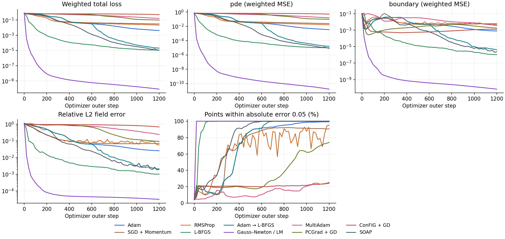

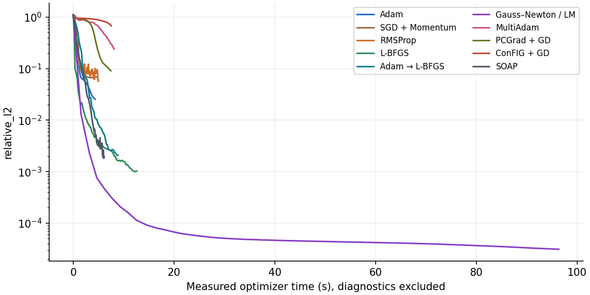

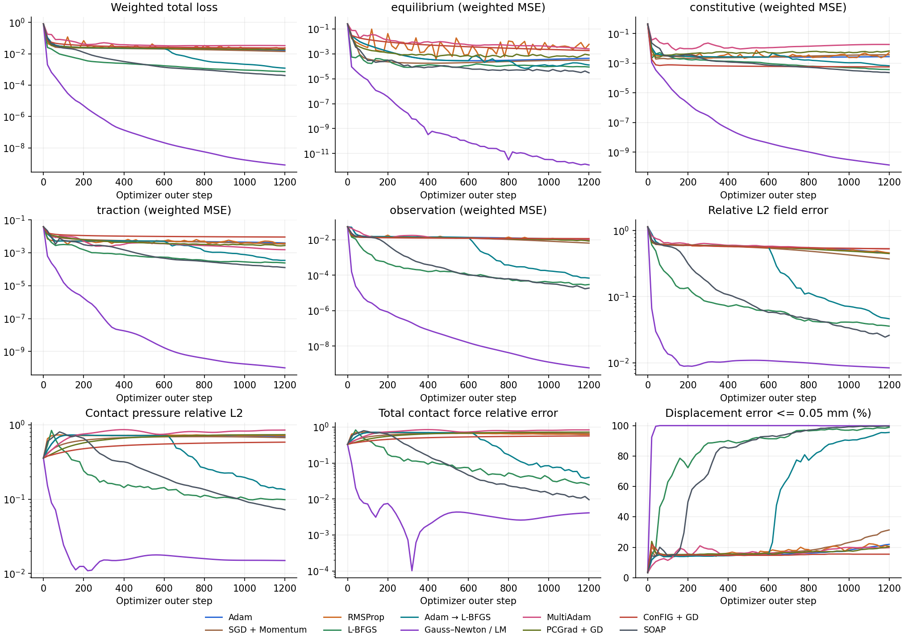

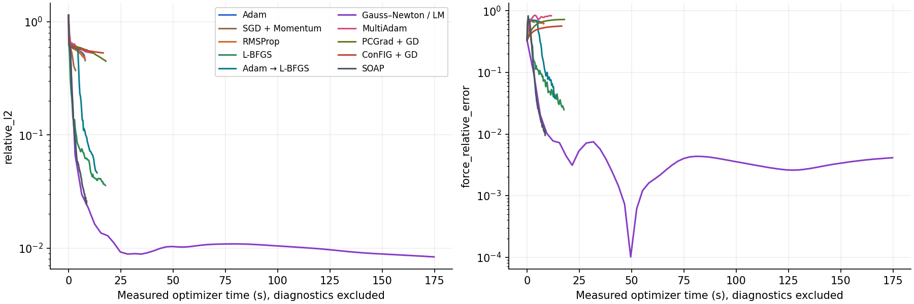

</details>

**二维温度场的训练动画**

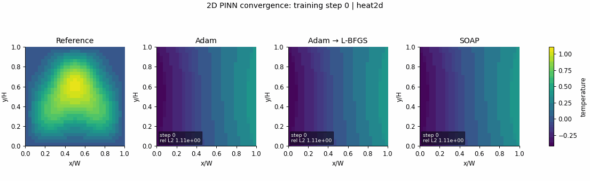

**位移观测驱动的压力反演动画**

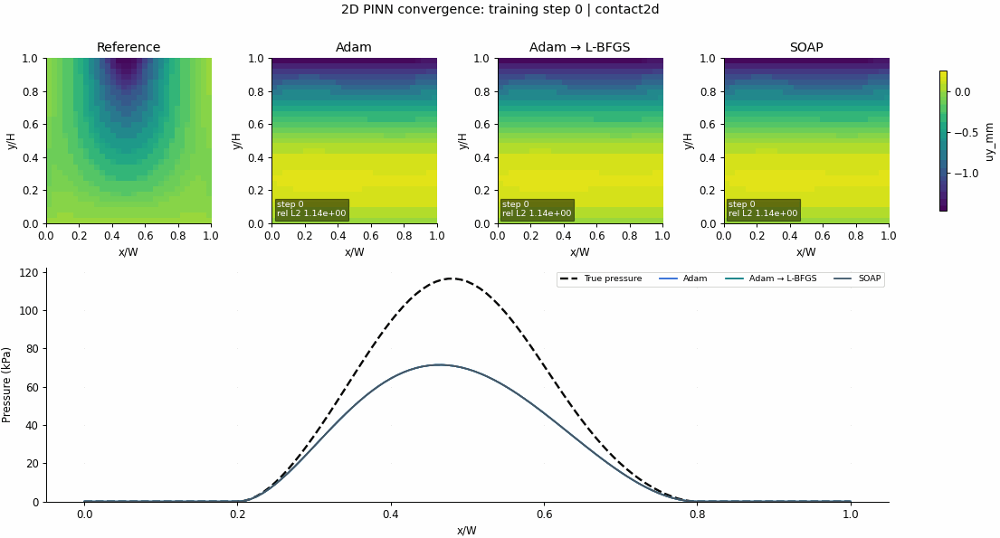

**压力分布、合力与训练成本对比**

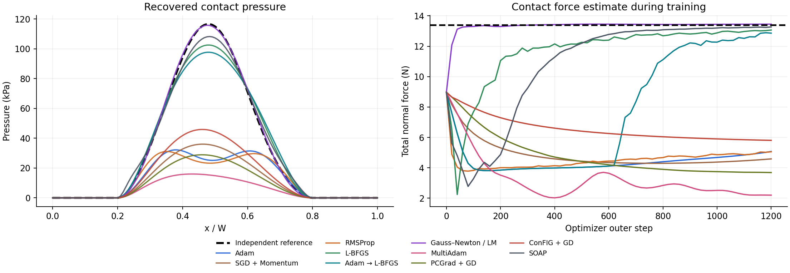

不能只看极小训练Loss：反演LM的训练平衡MSE约 $1.19\times10^{-12}$，但1024个独立留出点上为约 $1.00\times10^{-2}$；SOAP对应约 $1.39\times10^{-4}$。压力恢复较好并不证明整个域的平衡方程都已学好。

完整记录：[全部损失/误差/时间CSV](pinn_2d_optimizer_lab/runs/baseline/summary.csv) · [独立物理审计](pinn_2d_optimizer_lab/runs/baseline/independent_physics_audit.md) · [模型与参考解说明](pinn_2d_optimizer_lab/README.md)

## 3. 圆柱压刚性平面：Hertz / KKT负结果

采用小变形、线弹性、平面应变、无摩擦的力控制问题：$R=10$ mm、$E=200$ MPa、$\nu=0.3$、顶载 $q=0.5$ MPa、轴向厚度10 mm，已知全模型载荷100 N。接触约束为非穿透、无拉力和互补性，以Fischer–Burmeister残差训练。有限元使用主动集参考解，没有把Hertz压力当作训练标签。

**本组所有有限主结果都未成功拟合压力分布。** Loss下降或反力接近100 N均不能替代接触解精度验证。压力误差只在接触附近 $x/R\le0.3$ 比较，其余弧上的约束另行审计。

|方法|最终压力相对FEM误差|更新秒|外层步|记录状态|
|---|---:|---:|---:|---|
|Adam|95.485%|28.14|2400|达到步数上限|
|SGD + Momentum|95.003%|77.09|2400|达到步数上限|
|RMSProp|94.015%|71.77|2400|达到步数上限|
|L-BFGS|98.397%|120.12|1687|达到更新计时软上限|
|Adam → L-BFGS|98.334%|45.69|2400|达到步数上限|
|GN / LM*|97.895%|120.86|27|达到更新计时软上限|
|MultiAdam*|95.959%|115.37|2400|达到步数上限|
|PCGrad + GD*|数值失稳，见原始记录|11.31|120|非有限更新回退|
|ConFIG + GD*|96.231%|116.37|2400|达到步数上限|
|SOAP*|97.288%|31.49|2400|达到步数上限|
|DCGD-Center + GD*|96.231%|72.90|2400|达到步数上限|

**压力、间隙及预测变化动画（展示失败过程，不是成功拟合示例）**

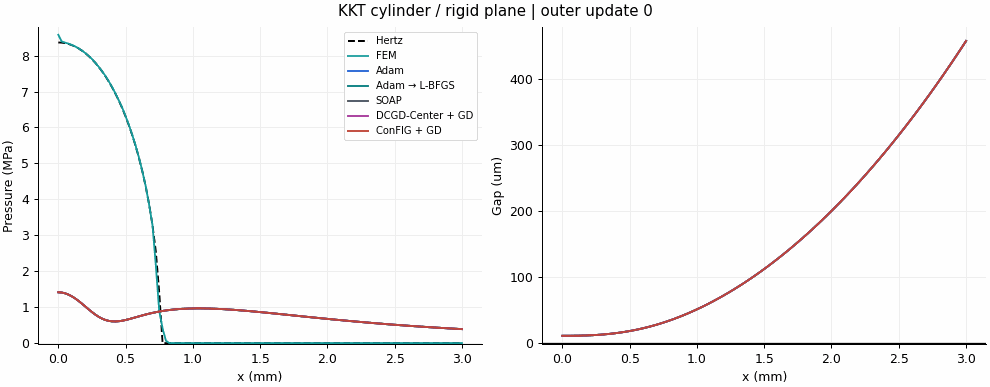

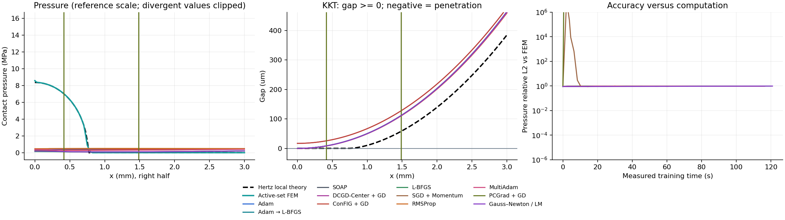

<details>
<summary>展开Hertz/KKT各项Loss与误差曲线（包含失稳方法）</summary>

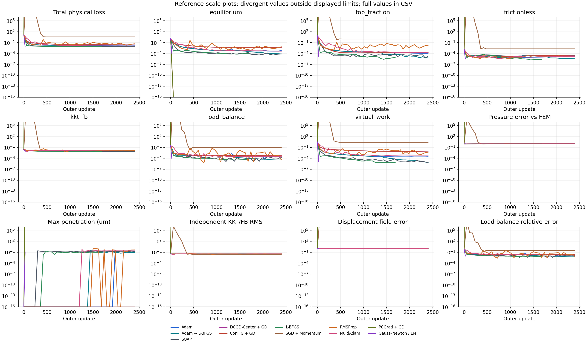

</details>

DCGD-Center与ConFIG另做了**相同两组目标、相同lr=0.001**的控制实验：该非退化两目标实现下方向等价，最终压力曲线的相对差约 $3.56\times10^{-5}$；两者都不准确。不能把这两条近乎相同的轨迹视为两个独立的算法优势证据。ConFIG在lr=.02时的非有限失败也保留在记录中。

[DCGD / ConFIG控制记录](hertz_cylinder_lab/runs/dcgd_config_control/controlled_comparison.json) · [失败尝试](hertz_cylinder_lab/runs/kkt_all11/failed_attempts.json) · [完整表](hertz_cylinder_lab/runs/kkt_all11/summary.csv) · [物理定义与KKT说明](hertz_cylinder_lab/README.md)

早期`*pilot*`使用过不同网络、损失或采样，不与主实验混排。`contact_seed_check`实际仍为seed=42，只改变了初始竖向偏置，不是额外随机种子。

## 4. 固定Adam，仅比较PDE / BC学习顺序

二维稳态热传导与Re=20 Kovasznay Navier–Stokes均有解析解。这里不再同时改变优化器：全部使用Adam、lr=.001，共同初始化和训练点，保留切换前后的Adam动量；每50步检查全部物理约束。

|组|训练方案|定义|
|---|---|---|
|A|始终Joint|每步 $L_f+L_{bc}$|
|B|BC → PDE → Joint|按计费时间约三等分，仅检查点切换|
|C|PDE → BC → Joint|B的顺序反转|
|D|ReLoBRaLo|每步自适应调整PDE/BC权重|
|E|规则自适应切换|按物理尺度归一化的边界RMSE、PDE残差、下降速度与梯度冲突决定动作；无控制器网络、无GN/JVP|

**统一约60秒计费预算；一个共同种子。下表为最终检查点，不用真解选最优模型。** NS主误差为合并速度，相应压力单列。

|方案|热传导相对 $L^2$|NS速度相对 $L^2$|NS压力相对 $L^2$|热 / NS外层步|
|---|---:|---:|---:|---:|
|A 始终 Joint|0.535%|0.639%|8.059%|8053 / 6200|
|B BC → PDE → Joint|0.790%|3.915%|48.906%|14995 / 11148|
|C PDE → BC → Joint|0.794%|3.983%|62.658%|14968 / 11231|
|D ReLoBRaLo|0.064%|0.682%|6.205%|8520 / 6431|
|E 规则自适应切换|0.198%|22.035%|56.412%|8656 / 12450|

**各项Loss、解误差、边界反弹和调度轨迹**

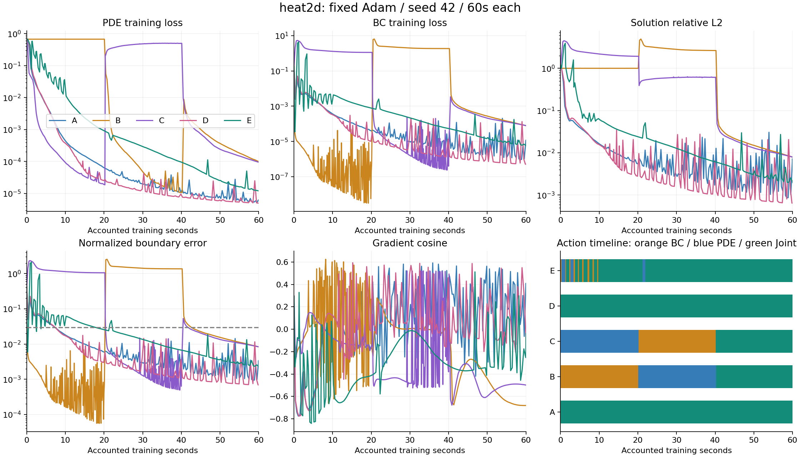

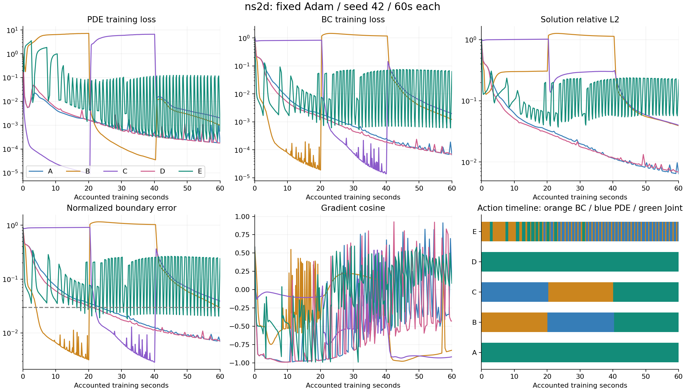

**共同计费时间下的预测回放：热传导温度截面**

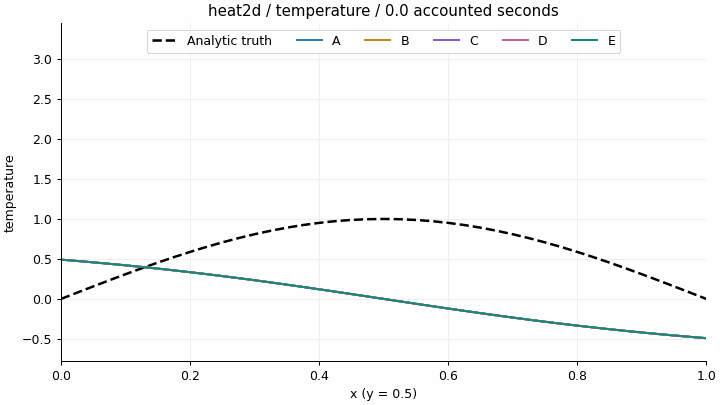

**NS速度和压力截面动画：** 横坐标为 $x$，截面 $y=0.5$；黑色虚线是解析解，彩色曲线是训练预测。仅显示当时已保存的快照，最终帧包含最后检查点的轻微预算超时。

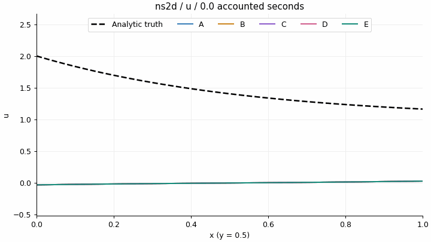

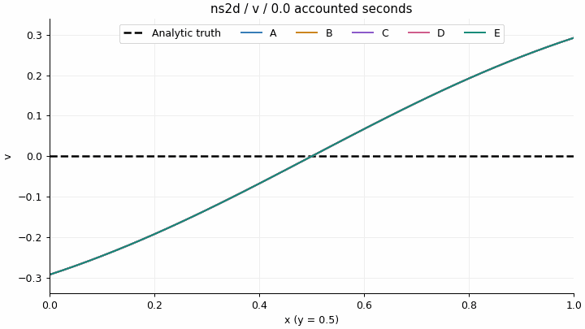

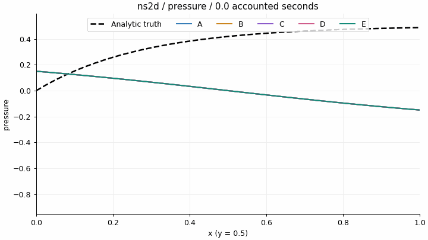

E在热传导优于A，但不如D；在NS中发生 **95次动作切换**，最终归一化边界误差 **0.24 > 0.03**。当前规则尚未显示自主调度优势。最小驻留和稀疏检查可能延迟恢复，但因果需消融，不能仅凭曲线确定。

诊断不是免费的：E在热传导与NS中的物理诊断约占计费时间 **2.88% / 4.85%**，规则计算本身很短。所有方法都带统一诊断，本轮没有免额外诊断A对照，因此不能把规则计算时间单独当成E的完整部署开销。

[完整实验报告](pinn_scheduler_lab/runs/scheduler60/REPORT.md) · [最终指标CSV](pinn_scheduler_lab/runs/scheduler60/final_metrics.csv) · [规则/阈值/计时口径](pinn_scheduler_lab/README.md)

## 5. 下一步构想：Curvature-Guided Adaptive Curriculum

以下是待验证想法，**没有对应训练结果**。已有课程学习、自适应加权和多目标方法，本文不因动态选任务就主张新颖性。

对归一化平方残差损失，采用一致的 $1/2$ 范数约定：

$$\mathcal L_i(\theta)=\frac12\|r_i(\theta)\|_2^2,\qquad g_i=J_i^\top r_i.$$

GN方向模型为

$$\Delta\mathcal L_i\approx g_i^\top d+\frac12\|J_i d\|_2^2.$$

边界恰满足时，$r_{bc}=0$使 $g_{bc}=0$，但更新仍可能破坏它：

$$\Delta\mathcal L_{bc}=\frac12\|J_{bc}d\|_2^2+O(\|d\|_2^3).$$

二次项仅在 $J_{bc}d\ne0$ 时严格为正；一般GN模型省略残差加权的二阶导数项，残差/步长大时可能失准。

拟从同一Adam/SOAP状态生成PDE、BC、Joint候选方向，用少量JVP估计收益、已满足约束的退化风险和计算成本，再选择目标并借鉴LM/信赖域检验预测。JVP、候选、探针与回退成本都须计入。

- **H1：** 方向曲率是否能预测一阶梯度难以发现的边界退化？
- **H2：** 收益是否来自选学习目标，而非仅调步长？需一阶调度与“GN只调步长”消融。
- **H3：** 计入全部开销后，是否降低Time-to-target与wall-clock time？

计划保留固定权重Adam/SOAP、固定课程、ReLoBRaLo、一阶调度、曲率调度和仅曲率步长六类对照，多种子验证。详见 [Research Note](reports/PINN_Optimization_Research_Note.pdf)。

## 下载与复现（不必重新训练）

```bash
git clone https://github.com/fengjianliuli-xsw/Adaptive-Curriculum-Optimization-for-Physics-Informed-Neural-Networks.git
cd Adaptive-Curriculum-Optimization-for-Physics-Informed-Neural-Networks
python -m venv .venv
# Windows PowerShell: .\.venv\Scripts\Activate.ps1
# Linux/macOS: source .venv/bin/activate
python -m pip install -r requirements.txt

# 校验并还原原始汇总JSON，无训练、无FEM重求解
python tools/restore_results.py

# 从原始日志重建离线看板；不重新训练、不重编码已有GIF
python tools/rebuild_dashboards.py --suite all
```

生成后用浏览器打开相应本地`dashboard.html`：

- `pinn_optimizer_lab/runs/demo/dashboard.html`
- `pinn_2d_optimizer_lab/runs/baseline/dashboard.html`
- `hertz_cylinder_lab/runs/kkt_all11/dashboard.html`
- `hertz_cylinder_lab/runs/dcgd_config_control/dashboard.html`
- `pinn_scheduler_lab/runs/scheduler60/dashboard.html`

已有GIF、PNG、逐方法JSON/CSV、配置、参考解与`.pt`最终权重都已直接提供。体积较大的重复汇总`results.json` / `data.json`以**字节保持的`.json.gz`**保存，恢复时校验SHA256；生成HTML与`data.js`不入库。原始本地目录、已压缩文件的校验值和省略页面清单见 [publication manifest](provenance/source_manifest.json)。

### 运行新训练

以下是**主动启动训练**的命令；查看既有结论无需执行。请使用新输出目录，避免覆盖记录。

```bash
# 1D: root下执行
python pinn_optimizer_lab/train.py --steps 1200 --out pinn_optimizer_lab/runs/reproduce

# A–E：先检查A基线，过门槛后才跑全部方案
python pinn_scheduler_lab/experiment.py --suite reproduce60 --baseline reproduce_baseline60 --budget 60 --seeds 42
```

二维优化器/Hertz入口保留了原工作区`F:/RA`的输出范围检查；Windows复现请将仓库放在`F:/RA/`下，其他系统需自行调整输出根目录限制。核心训练/PDE/优化器实现与原工作区逐字保留。各项目README包含更多参数。导出Research Note的历史脚本还保留本机路径与Windows中文字体依赖，不是跨平台通用Markdown转换器；PDF与可编辑正文可直接使用。

原始版本号按manifest/provenance保留；根requirements给出依赖范围，不承诺不同平台/版本下逐位复现或相同wall-clock时间。Playwright页面检查是可选工具，不是训练依赖。

## 文件与可信度

```text
pinn_optimizer_lab/       1D热方程、10方法、原始记录与动画
pinn_2d_optimizer_lab/    2D热传导、合成弹性载荷反演、FEM与独立审计
hertz_cylinder_lab/       Hertz/KKT、11方法、DCGD/ConFIG控制、历史pilot
pinn_scheduler_lab/      热传导/NS的A–E顺序对照、检查点与成本日志
reports/                 2页Research Note、证据、全部指标与复核记录
provenance/              公开快照SHA256、无损压缩映射、原ignore规则
tools/                   数据还原、看板重建、README表格生成与发布验证
```

主实验包括 **51个最终模型**；盘点包含smoke、pilot和基线预试在内共 **101条逐方法记录**。此前已只读复算主实验终点并保存证据；数值能从权重复算不等于证明模型满足全部物理或算法具有普遍优势。基线预试A的复用不算独立重复。

仓库不含虚拟环境、缓存、下载包和本机凭据。历史provenance中的绝对路径说明数据原来的位置；在本仓库中可用同名项目的相对路径找到对应文件。

## 参考文献（所用方法，不代表本仓库已全面复现）

- Rathore et al. *Challenges in Training PINNs: A Loss Landscape Perspective.* ICML 2024. [正式论文](https://proceedings.mlr.press/v235/rathore24a.html)
- Vyas et al. *SOAP: Improving and Stabilizing Shampoo using Adam for Language Modeling.* ICLR 2025. [论文](https://openreview.net/attachment?id=IDxZhXrpNf&name=pdf)
- Liu, Chu & Thuerey. *ConFIG: Towards Conflict-Free Training of Physics Informed Neural Networks.* ICLR 2025. [论文](https://arxiv.org/abs/2408.11104)
- Hwang & Lim. *Dual Cone Gradient Descent for Training Physics-Informed Neural Networks.* NeurIPS 2024. [正式论文](https://papers.nips.cc/paper_files/paper/2024/hash/b2b781badeeb49896c4b324c466ec442-Abstract-Conference.html)
- Bischof & Kraus. *Multi-Objective Loss Balancing for Physics-Informed Deep Learning.* CMAME 439 (2025), 117914. [DOI](https://doi.org/10.1016/j.cma.2025.117914)

完整方法分类与11条文献见 [Research Note](reports/PINN_Optimization_Research_Note.md)。

