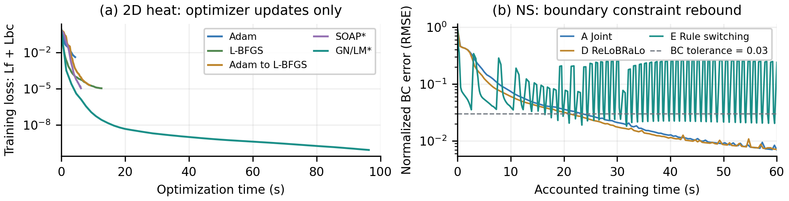

# PINN Optimization: Preliminary Experiments and Research Ideas

*Curvature-Guided Adaptive Curriculum Optimization*

Research Note | 2026-11-01 | 单种子预实验与待验证构想，不主张新颖性或已验证收益。

## 第1页：调研与初步实验

### Research Motivation

PDE 微分算子可能导致残差优化病态 [5]；PDE 与初边值约束的 Jacobian/曲率结构不同，梯度方向也可能冲突。问题不只在于如何下降总损失，还在于如何保留已经满足的物理约束。本文汇总已有预实验，并提出一个尚未实现的方向曲率诊断构想。

### Existing Optimization Methods

|类别 / 代表方法|主要作用与代价|仓库实际记录|
|---|---|---|
|一阶自适应：Adam / AdamW [1,2]|逐参数矩统计，更新成本低|Adam 已测；AdamW 未测|
|拟牛顿：BFGS / L-BFGS [3]|割线曲率与线搜索；closure 可重复|L-BFGS、Adam→L-BFGS 已测|
|二阶/残差：GN、LM、Newton-CG、NNCG [4,5]|GN用 JᵀJ；Newton-CG/NNCG用HVP/CG|仅阻尼 GN/LM* 已测，其余未测|
|结构化预条件：Shampoo / SOAP [6,7]|分层矩阵统计与基变换；非完整Hessian|SOAP* 已测；Shampoo 未单测|
|多目标方向：ConFIG / DCGD [8,9]|协调冲突梯度；需多任务梯度|ConFIG+GD、DCGD-Center+GD 已测|
|加权 / 课程：ReLoBRaLo、课程学习 [10,11]|调权或改变训练任务/难度|ReLoBRaLo、固定/规则顺序已测|

另测SGD+Momentum、RMSProp、MultiAdam、PCGrad。*为教学性自实现核心，不是官方完整实现复现。

### Preliminary Experiments

主表为二维稳态热传导 −ΔT=q：单位方域、零 Dirichlet；T*=sin(πx)sin(πy)+0.2sin(3πx)sin(2πy)。2-24-24-1 tanh（697 参数），内点128、边界64；Lf为除以2π²后的PDE残差MSE，Lbc为边界MSE，等权。CPU单线程float64、seed=42、同初始化/采样，均1200外层步。[E2]

|方法|最终 Lf+Lbc|相对L² (%)|更新计时(s)|循环wall(s)|外层步|
|---|---:|---:|---:|---:|---:|
|Adam|4.176e-03|2.55163|4.35|5.13|1200|
|L-BFGS|1.093e-05|0.10238|12.60|13.47|1200|
|Adam → L-BFGS|2.019e-05|0.20731|8.89|9.80|1200|
|SOAP*|1.096e-05|0.19560|6.16|7.13|1200|
|GN/LM*|8.454e-11|0.00311|96.37|97.22|1200|

图1：(a) 上表热传导原始检查点，优化计时不含诊断。(b) Kovasznay Re=20、2-32-32-32-3、内点256/BC128，Adam lr=.001、K=50；计费秒包含诊断与策略，循环wall约61–62秒。两图计时口径不同，不跨图比较速度。[E2,E4]

### Key Observations

1. 精度/成本：二维热传导LM终点耗时为SOAP的15.6倍；一维对应36.4倍 [E1,E2]。但首次记录达到1%误差，LM/L-BFGS/SOAP分别为3.18/2.87/3.85秒；仅LM达到0.1%（4.68秒）。等步终点比不能当等精度效率比；GN/LM是同一阻尼实现。
2. 耗时归因尚缺证据：代码每轮用jacrev显式构造J，再构造Gram、稠密求解并试探阻尼；热2D J为192×697、1D为272×697。没有分段profile，不能断言Jacobian或solve主导；没有GPU显存记录。
3. 损失下降不等于物理成功：二维载荷反演LM的训练平衡MSE约1.19e-12，但留出点为1.00e-2；圆柱接触的有限主结果压力误差约94%–98%，尚未成功 [E2,E3]。
4. 调度负结果：等60秒计费预算下，热传导E/A/D误差为0.198%/0.535%/0.064%；NS速度为22.03%/0.639%/0.682%。E切换95次，末e_bc=0.24；当前规则未胜过强基线，失败原因需消融 [E4]。

以上为seed=42的终点，不是统计推断；方法学习率和线搜索代价不同，未做同等调参搜索。所有主实验已有模型/日志复核；完整配置、其他方法和负结果见experiment_evidence.md。

## 第2页：研究构想（尚未实现与验证）

### Research Question

能否仅用少量方向曲率，判断下一阶段应学 PDE、BC 还是 Joint，并降低已满足约束的退化风险，而不执行完整 GN/LM？目标选择在形式上可视为离散权重/切换控制；不能仅以“动态选任务”主张新颖性，相关加权与课程研究已存在 [10,11]。

### Mathematical Motivation

令下标 i 表示物理约束块，n 为参数数、m_i 为残差数。残差按固定物理尺度归一化，并吸收 MSE 的样本数与固定权重，使以下平方范数与代码损失一致。

\[
\theta\in\mathbb{R}^n,\quad r_i\in\mathbb{R}^{m_i},\quad J_i=\frac{\partial r_i}{\partial\theta}\in\mathbb{R}^{m_i\times n},\quad\mathcal{L}_i=\frac{1}{2}\|r_i\|_2^2,\quad g_i=J_i^\top r_i
\]

\[
\Delta\mathcal{L}_i\ \approx\ g_i^\top d+\frac{1}{2}\|J_i d\|_2^2
\]

GN 忽略残差加权的二阶导数项，一般只是局部近似：残差或步长大时可能失准。边界残差恰为零且映射足够光滑时，下式成立；仅当更新方向不在边界 Jacobian 的零空间中，二次项才严格为正。这是已知最小二乘结构，不是新定理。

\[
r_{bc}=0\ \Longrightarrow\ g_{bc}=0,\qquad\Delta\mathcal{L}_{bc}=\frac{1}{2}\|J_{bc}d\|_2^2+O(\|d\|_2^3)
\]

### Preliminary Algorithm Idea

固定基础优化器；从同一 Adam/SOAP 状态模拟 PDE、BC、Joint 三种有符号候选方向，未接受前不提交动量。以正步长缩放得到候选更新，对归一化物理探针上的各约束，预测改善量为：

\[
d_a=\alpha_a p_a,\quad\widehat I_i(a)=-\alpha_a g_i^\top p_a-\frac{\alpha_a^2}{2}\|J_i p_a\|_2^2,\quad a\in\{\mathrm{PDE},\mathrm{BC},\mathrm{Joint}\}
\]

1. 触发诊断：每 K 步或约束下降停滞/接近阈值时，估计状态；第一版不用控制器网络。
2. 风险守护：用线性化残差按分量检查已满足约束的容许阈值；在可行候选中按预测收益/预计总成本排序。无可行候选则缩短步长并检查 Joint/BC；小梯度不能替代可行性判断。
3. 检验并更新：试探一步，用实际/预测下降比检验局部模型，借鉴 LM/信赖域缩放 α；接受后提交优化器状态。一个方向的预测不保证随后 K 步，须限制执行窗口并重新检查。

只计算方向JVP，不形成完整Jacobian或Hessian；三候选×两类约束最多需6个分块JVP/次诊断。PINN残差含空间导数，JVP可能涉及较高阶混合求导；触发、候选生成、回退、探针与动量状态成本都须计入，效率收益尚未验证。

### Planned Experiments

以下是下一轮计划，不将已有A–E结果误称为这些消融已完成。

|对照（全部为未来计划）|固定设置与主要辨别目标|
|---|---|
|① 固定权重 Adam / SOAP；② BC→PDE→Joint|基础解法与精调阶段长度基线；两种优化器分开比较|
|③ ReLoBRaLo；④ 仅一阶信息的目标调度|一阶调度使用损失进展、梯度及相同候选/守护检查|
|⑤ GN-JVP曲率目标调度；⑥ GN仅调步长|⑤与④检验曲率增量；⑤与⑥区分选任务和调步长|

H1：在BC近满足处，对比一阶/GN对边界反弹的预测误差、校准与风险排序；H2：固定候选、步长控制及调参预算，用④⑤⑥区分选目标与调步长的收益；H3：包含全部诊断与回退，比较达到预注册精度的墙钟耗时。

先用二维热传导与Re=20 Kovasznay NS，固定网络/采样/验证点，5个共同种子、每组120秒端到端训练预算。到达目标须解/速度相对L²≤1%且e_bc≤.03；未达记删失。报告PDE/BC loss、Time-to-target、wall、反弹峰值/超阈次数、调度成本；H3另用免额外诊断基线，分项profile Jacobian/JVP、Gram、solve与回退，并做K/最小驻留消融。

### References

[1] [Kingma & Ba. Adam: A Method for Stochastic Optimization. ICLR, 2015.](https://arxiv.org/abs/1412.6980)
[2] [Loshchilov & Hutter. Decoupled Weight Decay Regularization. ICLR, 2019.](https://arxiv.org/abs/1711.05101)
[3] [Liu & Nocedal. On the limited memory BFGS method for large scale optimization. Math. Program. 45:503–528, 1989.](https://doi.org/10.1007/BF01589116)
[4] [Marquardt. An Algorithm for Least-Squares Estimation of Nonlinear Parameters. J. SIAM 11:431–441, 1963.](https://doi.org/10.1137/0111030)
[5] [Rathore et al. Challenges in Training PINNs: A Loss Landscape Perspective. ICML, 2024.](https://proceedings.mlr.press/v235/rathore24a.html)
[6] [Gupta et al. Shampoo: Preconditioned Stochastic Tensor Optimization. ICML, 2018.](https://proceedings.mlr.press/v80/gupta18a.html)
[7] [Vyas et al. SOAP: Improving and Stabilizing Shampoo using Adam for Language Modeling. ICLR, 2025.](https://openreview.net/attachment?id=IDxZhXrpNf&name=pdf)
[8] [Liu, Chu & Thuerey. ConFIG: Towards Conflict-Free Training of Physics Informed Neural Networks. ICLR, 2025.](https://arxiv.org/abs/2408.11104)
[9] [Hwang & Lim. Dual Cone Gradient Descent for Training Physics-Informed Neural Networks. NeurIPS, 2024.](https://papers.nips.cc/paper_files/paper/2024/hash/b2b781badeeb49896c4b324c466ec442-Abstract-Conference.html)
[10] [Bischof & Kraus. Multi-Objective Loss Balancing for Physics-Informed Deep Learning. CMAME 439:117914, 2025.](https://doi.org/10.1016/j.cma.2025.117914)
[11] [Krishnapriyan et al. Characterizing possible failure modes in physics-informed neural networks. NeurIPS, 2021.](https://papers.nips.cc/paper_files/paper/2021/hash/df438e5206f31600e6ae4af72f2725f1-Abstract.html)

### 实验来源标识

[E1] `C:\Users\ASUS\Documents\ChatGPT\RA\pinn_optimizer_lab\runs\demo`；
[E2] `F:\RA\pinn_2d_optimizer_lab\runs\baseline`；
[E3] `F:\RA\hertz_cylinder_lab\runs\kkt_all11`；
[E4] `F:\RA\pinn_scheduler_lab\runs\scheduler60`。
主文数值来自逐方法JSON/CSV；独立物理审计来自相应audit文件；source SHA256与本次只读复核输出见experiment_inventory.json。
